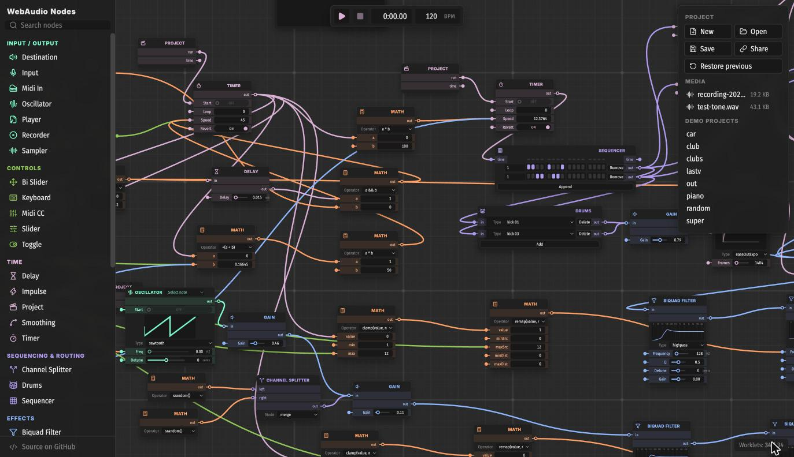
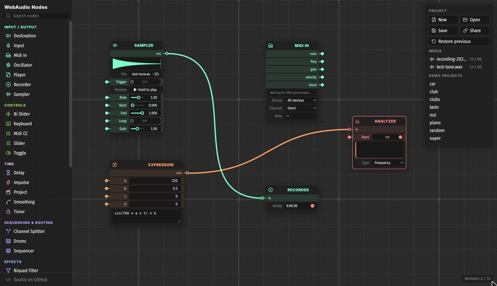
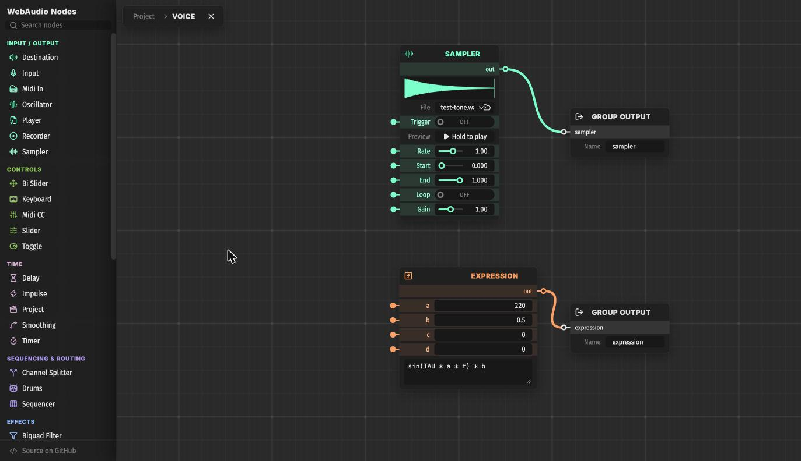

# WebAudio Nodes

[Русский](README.md) · **[Open in the browser →](https://vicimpa.github.io/w-nodes/)**

A modular synthesizer in the browser. You patch sound together from nodes (oscillators, filters, sequencers, samplers, math) and the wires between them. It runs on the Web Audio API: nodes are real `AudioNode`s and `AudioWorklet`s, and control signals run at audio rate rather than on JS timers.



## Features

- **Node editor**: drag, box-select, zoom, and copy and paste between tabs and projects.
- **30+ nodes**: oscillators, effects, analyzers, a step sequencer and drums, math, MIDI, a sampler, and recording.
- **Blocks**: build your own nodes out of other nodes. Select some, press <kbd>Ctrl</kbd>+<kbd>G</kbd>, and you get a block with ports. Blocks nest.
- **Expression**: a per-sample formula such as `sin(TAU * a * t) * b + y1 * 0.5`, compiled to an AudioWorklet by a dedicated safe parser.
- **Media library**: audio files are stored in the browser and embedded into projects. **Sampler** plays them sample-accurately, and **Recorder** records straight into the library.
- **MIDI**: keyboards and controllers via Web MIDI.
- **Projects persist**:
  - autosave;
  - `.wnodes` files;
  - share a whole project as a link;
  - one click to get the previous project back.

| Nodes up close | A block and its insides |
|---|---|
|  |  |

## Quick start

```bash
git clone https://github.com/vicimpa/w-nodes.git
cd w-nodes
npm install
npm run dev      # http://localhost:5173
npm test         # vitest
npm run build    # tsc + build into dist/
```

## Using it

1. Add a node from the left menu. A click places it at the center of the screen; you can also drag it to where you want it.
2. Drag a wire from port to port. Wires take the colour of the node they come from.
3. **Destination** is your speakers.
4. Try a demo from the right panel: `car`, `club`, `piano`, `lastv`, and others. The note inside each demo says which keys to press. `car` is a V8 revving to 10,900 rpm with a 5-speed automatic gearbox, a turbo and a dashboard, its sound built on the `car-classic` chain: Space starts the engine, W is the throttle, S is the brake; the original version is kept as `car-classic`. The newer nodes are shown off in `orbit` (a sound circling your head through the Panner; use headphones), `bells` (generative FM bells built from Random and Expression), `arp` (an arpeggio from Counter and Constant), `theremin` (a Bi Slider theremin) and `midi` (a synth for a MIDI keyboard).

### Ports

| Look | Carries |
|---|---|
| ◯ ring | **audio** (stereo), between sources and effects |
| ● dot | **signal** (mono, at audio rate): parameter values, modulation, triggers |

You can connect the two kinds to each other. The port colour shows the node's category.

Almost every parameter row has its own signal input. While that input is connected, the control turns into a readout of the incoming value.

### Shortcuts

| Keys | Action |
|---|---|
| <kbd>Space</kbd> | Play / stop and rewind (when the project has a **Project** node) |
| <kbd>Ctrl</kbd>+<kbd>Z</kbd> / <kbd>Ctrl</kbd>+<kbd>Shift</kbd>+<kbd>Z</kbd> (or <kbd>Ctrl</kbd>+<kbd>Y</kbd>) | Undo / redo |
| <kbd>Delete</kbd> / <kbd>Backspace</kbd> | Delete the selection |
| <kbd>Ctrl</kbd>+<kbd>A</kbd> / <kbd>C</kbd> / <kbd>X</kbd> / <kbd>V</kbd> / <kbd>D</kbd> | Select all / copy / cut / paste / duplicate |
| <kbd>Shift</kbd> + copy/paste | Leave out wires to nodes outside the selection |
| <kbd>Ctrl</kbd>+<kbd>G</kbd> / <kbd>Ctrl</kbd>+<kbd>Shift</kbd>+<kbd>G</kbd> | Collapse the selection into a block / expand a block |
| <kbd>Esc</kbd> | Close the open block |
| Wheel / <kbd>Ctrl</kbd>+wheel / middle-drag | Pan / zoom / pan |
| Drag on empty space | Box select (add <kbd>Shift</kbd> to extend the selection) |
| <kbd>Shift</kbd>+click a node title | Add the node to the selection or remove it |
| <kbd>Alt</kbd> while dragging a node | Move without snapping (nodes snap their edges and centers to neighbours) |
| <kbd>Ctrl</kbd>+drag from a port | Pick up all of that port's wires |
| Click a wire | Detach it and drag it |
| Right-click a slider | Reset it to its default |
| <kbd>Ctrl</kbd>+right-click a node, then <kbd>Ctrl</kbd>+click another | Copy settings to a node of the same type |

On macOS use <kbd>⌘</kbd> instead of <kbd>Ctrl</kbd>.

### Projects

- **Autosave.** The project and the view are saved in the browser every couple of seconds.
- **New / Open / Save** work with `.wnodes` files, which embed the media the project uses.
- **Share** copies a `#p=…` link that contains the whole project. Media is included when it is small (up to 256 KB); otherwise share the file.
- **Restore previous** brings back what you had before opening a demo, a link or a file.
- **Arrange nodes** lays out the selection (or everything) left to right along the signal flow without overlaps; <kbd>Ctrl</kbd>+<kbd>Z</kbd> undoes it.
- **Drop files on the canvas.** A project file is pasted in; an audio file becomes a Sampler.
- **Old project strings still load.**

### Blocks

1. Select nodes and press <kbd>Ctrl</kbd>+<kbd>G</kbd>. Wires that left the selection become the block's ports.
2. **Open block** shows what's inside.
3. **Group Input** and **Group Output** nodes inside the block are its ports, and their names are the port labels.

Blocks copy, save and nest like any other node. <kbd>Ctrl</kbd>+<kbd>Shift</kbd>+<kbd>G</kbd> unpacks a block back into its nodes.

The **Compiled** switch turns a block into one AudioWorklet when it holds only Math, Expression, Memory, Slider, Toggle, LFO, ADSR, Counter, Random and Group Input/Output nodes. Feedback inside such a block is delayed by 1 sample instead of 128. If the block can't be compiled, it plays as usual and shows the reason on its face.

### Expression

The formula is evaluated every sample. Projects carry the formula as text. Opening a shared link **never runs it as JavaScript**: a dedicated parser accepts only the following.

- **Inputs:** `a b c d`.
- **Variables:** `t` (seconds), `sr` (sample rate), `y1` (the previous output sample, for 1-sample feedback).
- **Constants:** `PI E TAU`.
- **Operators:** `+ - * / % **`; comparisons (they give 0 or 1); `&& || !`; `?:`.
- **Functions:** `sin cos tan asin acos atan atan2 sinh cosh tanh exp log log2 log10 pow sqrt abs sign floor ceil round trunc min max clamp mix fract mod noise`.

### Media, Sampler, Recorder

- **Sampler:**
  - starts sample-accurately on a rising `Trigger` edge;
  - 8 voices;
  - rate (negative values play backwards);
  - start and end points;
  - loops while the trigger is held.
- **Player** plays long files with standard controls.
- **Recorder** records its input into the media library, so a take can go straight into a Sampler or be downloaded.
- **Storage.** Files live in the browser's IndexedDB and are never uploaded anywhere.

### MIDI

- **Midi In** outputs `note`, `freq`, `gate`, `velocity` and `bend`. It is mono with last-note priority.
- **Midi CC** outputs a controller value from 0 to 1. **Learn** picks up the CC number from the first knob you move.
- Web MIDI is required: Chrome or Edge, or Firefox once you allow it for the site.

## Nodes

| Category | Nodes |
|---|---|
| **Input / Output** | Oscillator, Sampler, Player, Input (microphone), Midi In, Recorder, Destination |
| **Controls** | Slider, Toggle, Bi Slider (XY pad), Keyboard (computer keys), Midi CC |
| **Time** | Timer, Delay, Smoothing (eased glide), Impulse, LFO, ADSR (envelope), Project (transport: run, time) |
| **Sequencing & Routing** | Sequencer (16 steps), Drums, Channel Splitter (split / merge / swap) |
| **Effects** | Gain, Biquad Filter, Convolver (reverb), Dynamics Compressor, Panner (3D, top-down view with cone and falloff curve), Stereo Panner |
| **Math & Memory** | Math (~70 operations and functions), Expression, Constant (π, e, φ, sample rate… or your own number), Memory (sample & hold), Random, Counter |
| **Monitors** | Analyzer (spectrum/waveform), Oscilloscope (XY), Show Value, Turner (signal plotter) |
| **Blocks** | Group, Group Input, Group Output |

## For developers

- [docs/ARCHITECTURE.md](docs/ARCHITECTURE.md) explains how the editor, nodes, worklets, the project format, media and blocks work, and how to add a node.
- [docs/ROADMAP.md](docs/ROADMAP.md) covers what's next, the path to a DAW, and known issues.

Both documents are in Russian.

The node design follows the **CUSTOMITY** mockup.

## License

MIT
